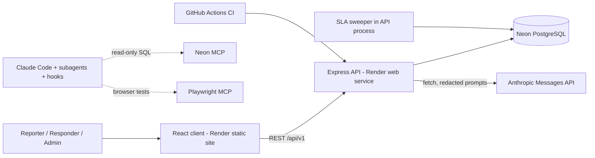
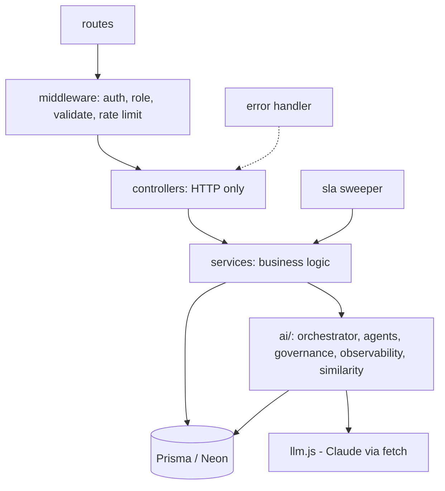
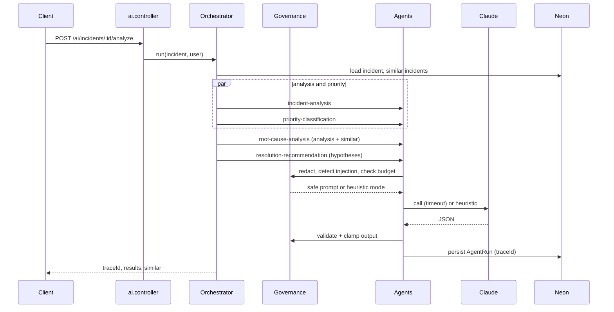
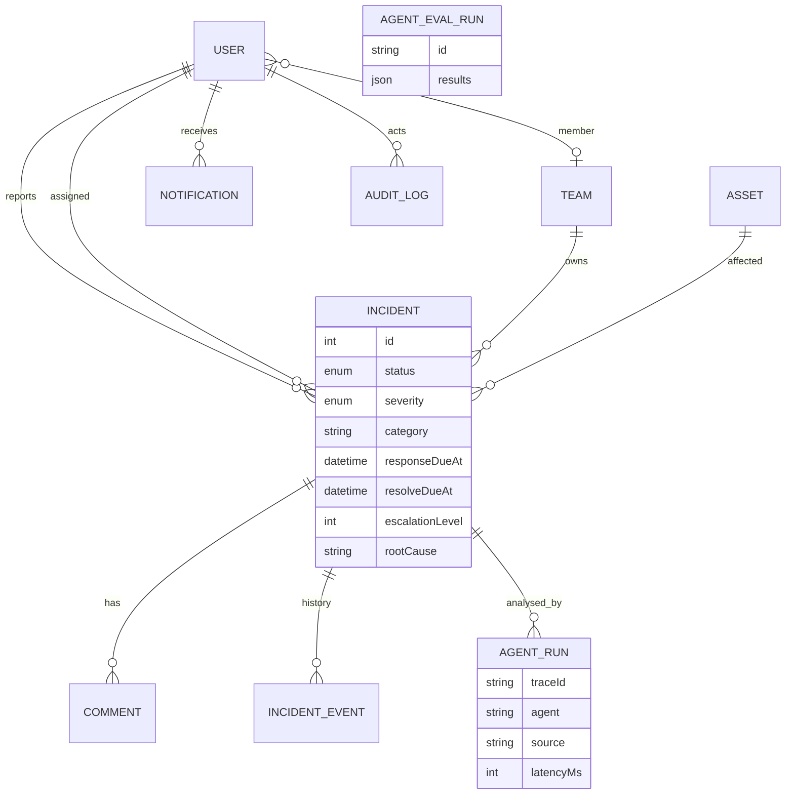
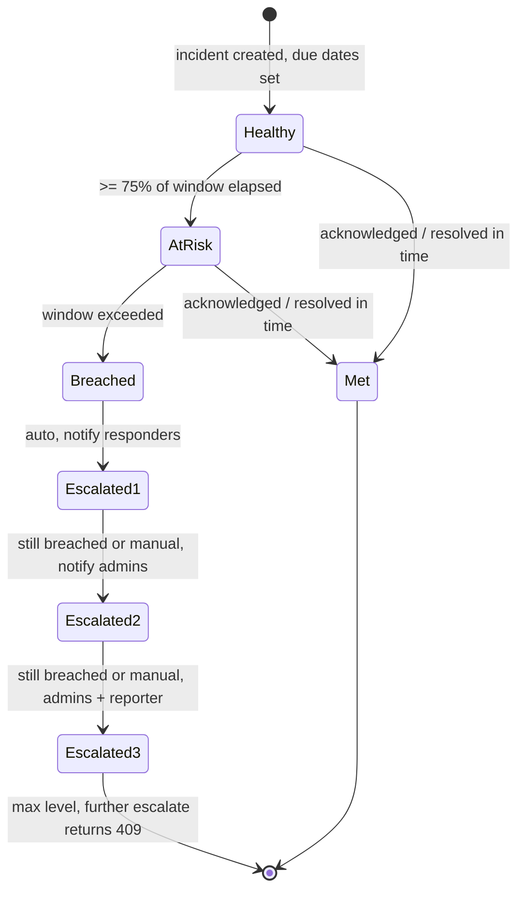
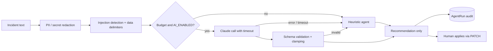
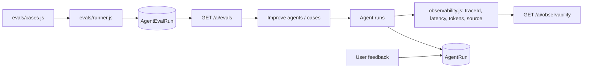

# IncidentHub Architecture

AI-powered IT service management: React client, Express API, Neon PostgreSQL via Prisma, six Claude agents with a heuristic fallback, an SLA sweeper, and governance, observability and evaluation layers.

## 1. System context

## 2. Backend layering

## 3. AI orchestration sequence

SLA monitoring runs on the sweeper schedule or `POST /ai/sla/monitor`; reporting runs on `POST /ai/reports/executive`.

## 4. Data model

## 5. SLA and escalation flow

## 6. Governance controls

## 7. Observability and evaluation loop

## Claude Code layer

`.claude/agents` (six agents, orchestrator, evaluator), `.claude/skills` (triage, RCA, SLA review, evaluation, reporting), `.claude/hooks` (guard-bash, protect-secrets, post-edit-check, audit-log) and `.mcp.json` (Neon, Playwright). See SKILL.md sections 5 and 16.
